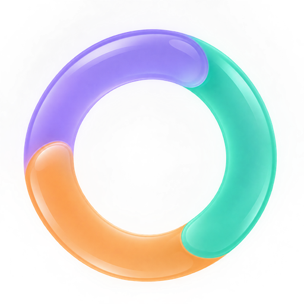
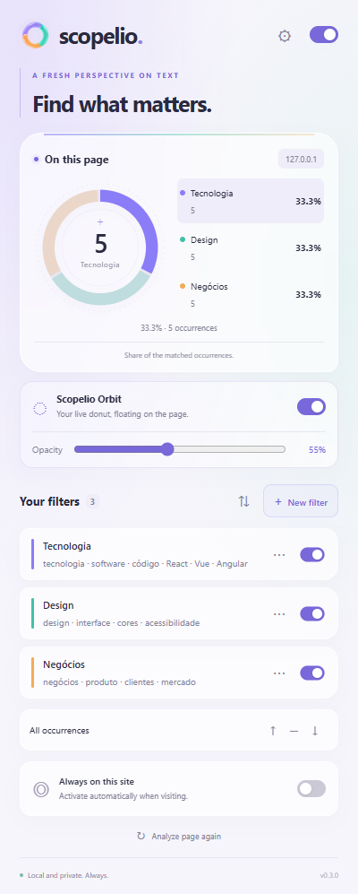
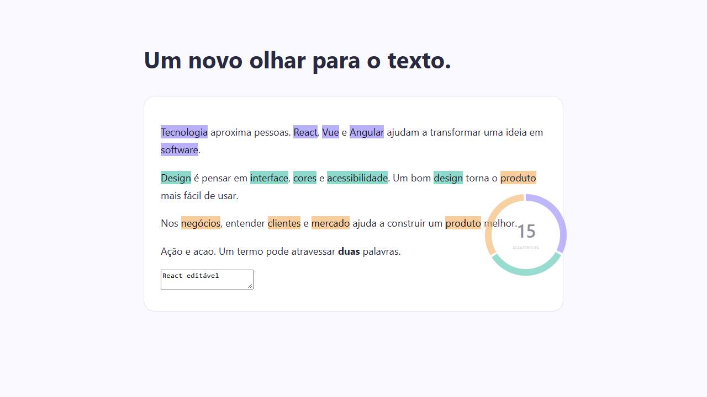
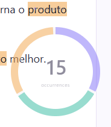

<p align="center"></p>
<h1 align="center">Scopelio</h1>
<p align="center"><strong>Color Highlights & Donut Analytics</strong><br>Your words. Your colors. More clarity.</p>
<p align="center"><a href="LICENSE">MIT License</a> · <a href="README.pt-BR.md">Português (Brasil)</a> · <a href="https://github.com/blajeen/Scopelio/releases">Downloads</a> · <a href="https://github.com/blajeen/Scopelio/issues">Report a bug</a></p>

Scopelio is an open-source browser extension that highlights your terms in any authorized web page and shows their distribution in a donut chart. Create color-coded filters, see which topics appear most often, and jump straight to each match.

Built with a minimal liquid glass interface: soft translucency, subtle borders, and colors that keep your filters in focus. **English is the default language; Brazilian Portuguese is available in Preferences.** All analysis runs locally.

<p align="center"></p>

## Features

- **Named filters:** up to **2,000 terms per filter**, each with its own color.
- **Text backups:** export filters to `.txt`, or import a backup or a plain list of terms with a preview and add/replace options.
- **Flexible matching:** whole words, case sensitivity, and accent-insensitive search.
- **Color highlights:** browser-native text highlights without rewriting page HTML.
- **Donut analytics:** total occurrences, count and percentage per filter.
- **Scopelio Orbit:** an optional, background-free floating donut that stays on the page, with adjustable opacity, drag positioning, keyboard movement and match navigation.
- **Match navigation:** previous/next across all matches or one selected filter.
- **Site controls:** global pause and optional automatic activation per site.
- **Dynamic content:** updates when page text changes.
- **Two languages:** English and Brazilian Portuguese, saved between sessions.
- **Appearance:** light, dark, system theme, and reduced transparency.
- **Privacy:** no account, tracking, analytics, external scripts, or page uploads.



## Install

Scopelio v0.3.0 is available as a manually installed extension. Store publication is still pending. Supports **Chrome and Microsoft Edge 120+**. Firefox and Safari are not supported in this release.

1. Download `scopelio-0.3.0.zip` from [Releases](https://github.com/blajeen/Scopelio/releases/latest) and extract it. Alternatively, clone this repository and use its `extension` folder.
2. Open `chrome://extensions` in Chrome or `edge://extensions` in Edge.
3. Enable **Developer mode**.
4. Choose **Load unpacked** and select the extracted folder containing `manifest.json` (or the repository's `extension` folder).
5. Open a regular HTTP/HTTPS website and click the Scopelio toolbar icon. Pin it for easy access.

No dependencies or build step are required to use the extension.

## How to use

1. Click **New filter**. Enter a name such as `Technology` and terms such as `React, Vue, Angular`.
2. Choose a color and matching options, then save. Separate terms with commas or new lines.
3. View the highlights and donut. The legend shows each filter's count and percentage.
4. Select a filter in the legend to narrow navigation; use **↑ / ↓** to jump through matches. Click it again to navigate all matches.
5. Enable **Always on this site** if you want automatic highlighting on future visits. The browser asks for access to that site.
6. Open **Preferences** (gear icon) to change language, theme or transparency. Use the top switch to pause Scopelio globally.

Filters are saved in your local browser profile. Disabling automatic activation removes the corresponding optional site permission. The popup can still analyze the current page when opened manually.

### Scopelio Orbit



Enable **Show floating donut** below the chart to keep your analytics on the page after closing the popup. Orbit has no panel background: its center and unused space let clicks pass through to the website. Select a colored arc to focus that filter, then use the arrows to navigate its matches. Select the same arc again to return to all matches.

Drag the `scopelio / orbit` handle to place it anywhere, or focus the handle and use arrow keys (Shift for larger steps). Position is saved locally and remains within the viewport after resizing. Adjust opacity from **20% to 100%** in the popup, or use the controls revealed when hovering over or focusing Orbit. Controls become fully visible during interaction. The reset button returns it to the lower-right corner; × turns off the floating donut. Global pause also hides Orbit. Automatic display on future visits requires **Always on this site**.

Hover over a colored arc to preview that filter's count and share; other colors soften to keep your focus. This also works with keyboard focus. Orbit updates with dynamic page content even when the popup is closed. Its own labels and controls are excluded from page analysis. No additional permissions or external services are required.

### Import and export .txt

Click **⇅** next to **Your filters** to open **Import or export filters**. **Export .txt** downloads all filters, including disabled filters, preserving names, terms, colors and matching options. **Import .txt** shows a preview; choose **Add to my filters** (default) or **Replace my filters**, then confirm with **Import filters**. Canceling or selecting an invalid file leaves your saved filters intact.

You can also import a UTF-8 `.txt` containing one term per line (commas are accepted). It becomes a single filter named after the file, using the default purple color. Backups use versioned, readable structured text so multiword terms and all options survive a round trip. Importing regenerates internal IDs. Limits remain 40 filters, 2,000 terms per filter, and 160 characters per term; files must be no larger than 16 MB. Imported content never grants website access or changes appearance preferences.

See the [file format and examples](docs/TEXT_FILTERS.md).

## Understanding the chart

`Filter percentage = matches assigned to that filter ÷ all assigned matches × 100`.

The chart measures **matched occurrences**, not the percentage of the full text, semantic importance or sentiment. Rounded percentages may not add up to exactly 100%.

An occurrence belongs to one filter. Overlapping matches are resolved by earliest starting position, then longest term at that position, then filter creation order. Duplicate normalized terms within a filter count once. Search is literal; regular expressions are not supported.

## Privacy and permissions

Page text and match results are processed in memory and are not uploaded or persisted. Filters, settings, and automatically enabled sites are stored in `chrome.storage.local`. Scopelio does not enable cloud sync.

| Permission | Purpose |
| --- | --- |
| `activeTab` | Temporary current-page access after you invoke the extension. |
| `scripting` | Run the local analyzer and highlighter on authorized pages. |
| `storage` | Save filters and preferences locally. |
| Optional HTTP/HTTPS site access | Automatically analyze a site when you enable that option. |

Read the complete [privacy policy](PRIVACY.md). Removing the extension clears its local storage through the browser's uninstall mechanism.

## Scope and limits

The analyzer reads rendered text in the main document, including content outside the viewport. It skips hidden content, editable fields, buttons and scripts. Images, PDFs, browser-internal pages, iframes and Shadow DOM are excluded. Protected pages, including extension stores, may block access. Phrases split across inline elements in one text block are supported; structural block boundaries may interrupt phrases.

Limits: **40 filters**, **2,000 terms per filter**, **160 characters per term**, **1.5 million page characters**, and **20,000 candidate occurrences** per scan. Large-page limits produce an explicit partial-analysis notice. Term matching uses a cached Aho–Corasick automaton to scan dictionaries efficiently.

## Development

Node.js 22+:

```sh
npm ci
npm test
npx playwright install chromium
npm run test:browser
npm run build
```

The build creates `dist/scopelio`; on Windows it also creates `dist/scopelio-0.3.0.zip`. Runtime code has no third-party dependencies and needs no bundler. Playwright is used only for development tests.

```text
extension/       Manifest, popup, translations, matching engine, content script
tests/           Unit tests and Chromium integration tests
scripts/         Distribution packaging
docs/            Screenshots, icon and store publishing checklist
```

Integration tests load a real extension in an isolated Chromium profile. The test-only manifest pre-grants localhost access because opening a popup URL does not simulate the toolbar's `activeTab` gesture. The distributed manifest does not contain that permission. Actual browser permission prompts require the [manual release checks](CONTRIBUTING.md).

## Contribute

Bug reports, accessibility improvements, translations and focused pull requests are welcome. Read [CONTRIBUTING.md](CONTRIBUTING.md), include reproduction steps, and avoid sharing sensitive page content in public issues.

Planned improvements include filter collections and additional browser support. These are not part of v0.3.0. Store submission follows the [publishing checklist](docs/STORE_CHECKLIST.md).

## License

[MIT](LICENSE). The app icon was created using OpenAI's built-in image generation tool; its prompt and processing notes are in [docs/BRAND.md](docs/BRAND.md).
